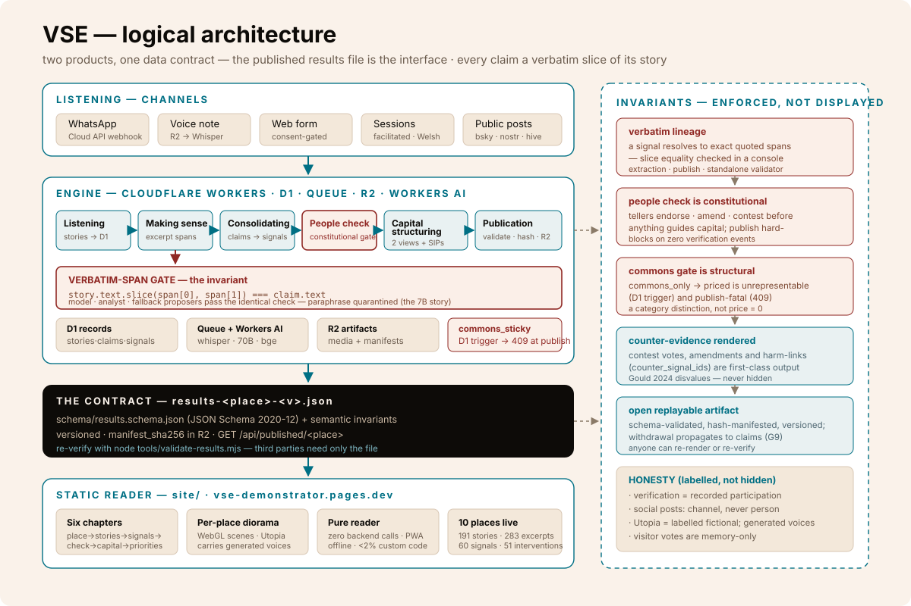

# Logical Architecture

Two products, one data contract. The **engine** produces a place's
results file; the **demonstrator** renders it. Everything between them is
one versioned, schema-validated, hash-manifested JSON artifact — anyone
can re-verify or re-render it with independent code. Source of truth is
the repo (`PRD.md`, `schema/results.schema.json`); this maps it.

## Intake layer (channels)

| Channel | Component | Notes |
|---|---|---|
| WhatsApp | Meta Cloud API webhook → Worker | Voice notes route through Whisper |
| Voice | Upload → R2 → Queue → Workers AI Whisper | Original audio retained for audit |
| Web form | Static form + Turnstile | No account; `consent !== true` → 422 |
| Facilitated session | Console paste-in | Facilitator assigns role + language; Welsh kept with translation alongside |
| Public social posts | `tools/social/` exports → `social` channel | Source URL is the canonical post — click-through provenance; attributed to network, not person |

Every story records `place_id`, `channel`, `teller_role`, `text`,
`language`, `consent`. Consent precedes processing; withdrawal propagates
to claims (validator check 8).

## Pipeline (`engine/` — Cloudflare)

| Stage | What runs | Gate |
|---|---|---|
| Listening | `POST /api/places/:id/stories` → D1; media → R2; jobs → Queue | PII flag pass; consent |
| Making sense | Workers AI (`@cf/meta/llama-3.3-70b-instruct-fp8-fast`) proposes `{text, span}` claims | **Slice-equality gate** — `story.text.slice(span) === claim.text`; model, analyst and deterministic-fallback proposers pass the *identical* check; paraphrases quarantined |
| Consolidating | bge embeddings + k-means propose clusters; analyst authors signal statements | `voices`/`recurrence` derived at publish, never hand-entered |
| People check | Participants (tellers) respond endorse/amend/contest per signal; magic-link/OTP or facilitator-mediated | Constitutional: publish warns below 50% reach, hard-blocks at zero verification events |
| Capital structuring | Analyst maps interventions in `from_plans` + `from_place` views; SIPs; counter-signals | `counter_signal_ids` may only reference verified signals |
| Publication | Assemble → run both validator layers → derive counts → hash | Versioned `results-<place>-<v>.json` + `manifest_sha256` in R2; `GET /api/published/<place>` serves it |

**The commons gate (structural, not cosmetic):** `gate: commons_only` is
sticky — a D1 trigger (`commons_sticky`) makes the
`commons_only → may_be_priced` transition unrepresentable, and publish
rejects any `priced` intervention referencing a commons-gated signal
with HTTP 409. Confirmed live.

**Proof the gate works:** 7B/8B-tier instruct models reliably *elaborate*
short fragments instead of copying them; the span check quarantined every
such proposal — the 70B model copies verbatim and a mechanical heal fixes
off-by-one spans.

## The contract (`schema/` + `tools/`)

| Layer | What it checks |
|---|---|
| `schema/results.schema.json` | Structure — JSON Schema 2020-12, every enum |
| `tools/results-lib.mjs` (semantic layer) | Span integrity; referential + bidirectional claim↔signal refs; derived `voices`/`recurrence`/pipeline counts; verification tallies ≤ participants; gate semantics (no `priced` ← `commons_only`); withdrawal integrity |
| `tools/validate-results.mjs` | Runs both layers; exits non-zero with a findings list |
| `tools/run-pipeline.mjs` + `tools/places/*.spec.json` | Reproduces each live run — spec lints verbatim-corpus membership *before* any API call |

## Presentation layer (`site/`)

| Surface | Component | Notes |
|---|---|---|
| Landing `/` | globe (cobe) + step strip + follow-one-sentence threads + preview gallery | counts derived live from `data/index.json` |
| Place pages `/<place>` | six chapters: `#place #stories #signals #check #capital #priorities` | per-place WebGL diorama (three.js via r3f); Utopia carries generated voice audio |
| Reader | React + Vite + Tailwind + PWA | **pure reader**: zero backend calls, zero AI calls, zero analytics; works offline after first load; renders any conforming results file |

Legacy `?place=<id>#<hash>` links redirect to `/<id>#<hash>`.

## External systems

- **Springforth (estate seam, FR-E25)** — publish may emit
  possibility-card drafts + verified-need nodes for the funding layer.
  Data-only, optional, never a runtime dependency (and the source of the
  five field-record places' corpora).
- **OpenTimestamps (optional)** — publication hash anchoring; the
  manifest hash stands alone without it.
- **Rooted audience-identity index** — the ~5.7M-post public social
  corpus that `tools/social/` scans; text_match first, author_location
  sparingly and labelled.

## Why this shape

- **The artifact is the interface** — engine and site never talk at
  runtime; the results file between them is the whole contract, so the
  demo can't lie about what the engine produced.
- **The invariant is un-libraried** — slice equality is
  `String.prototype.slice`; a judge can check it in a console.
- **Legitimacy is load-bearing** — the people check and the commons gate
  exist because the science (member-checking, IPBES relational values,
  deliberative polling) says trust is the mechanism, not the garnish.
- **Fail-soft** — every channel degrades to manual entry; extraction down
  means analysts hand-enter claims through the same gate.
